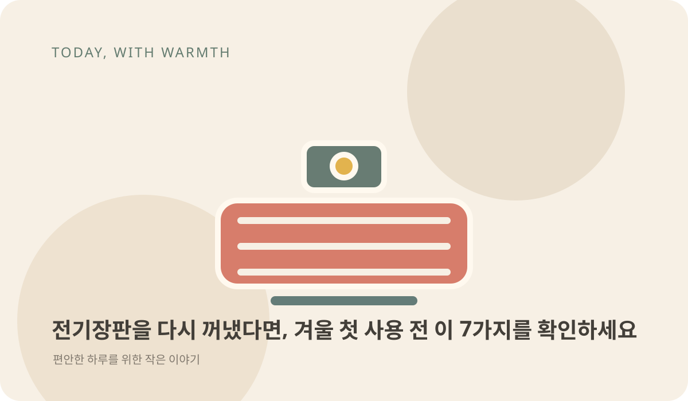

# 전기장판을 다시 꺼냈다면, 겨울 첫 사용 전 이 7가지를 확인하세요

> **한 줄 요약:** 행정안전부가 발표한 최근 5년 전기장판·전기난로 화재는 2,354건입니다. 접힘·눌림·전선 손상·주변 가연물을 확인하고, 사용 뒤에는 전원을 끄고 플러그를 뽑으세요.

> 이미지: 글 주제에 맞춰 매거진에서 직접 만든 그림입니다.

날씨가 쌀쌀해지면 창고에 넣어둔 전기요와 전기장판부터 찾게 돼요. 그런데 전원을 켜기 전, 지난겨울 마지막으로 어떻게 보관했는지 기억나시나요? **겨울철 난방용품은 꺼내는 날 한 번 점검하는 것만으로도 위험을 줄이는 데 도움이 됩니다.**

**행정안전부는 2026년 11월 18일 겨울철 전열제품 화재 예방을 당부했어요.** 발표에 따르면 2021년부터 2025년까지 전기장판·전기담요·전기방석과 전기난로 관련 화재는 2,354건이었고, 이로 인해 37명이 숨지고 219명이 다쳤습니다.

| 공식 발표 수치·권고 | 내용 | 집에서 확인할 점 |
|---|---|---|
| 최근 5년 화재 | 2,354건 | 제품과 전선의 사용 흔적 |
| 인명 피해 | 사망 37명, 부상 219명 | 취침 전 전원·타이머 확인 |
| 전기장판 화재 | 부주의 532건 중 사용·설치 부주의 461건(87%) | 접힘, 눌림, 과도한 이불 덮개 |
| 전기난로 화재 | 부주의 674건 중 주변 가연물 344건(51%) | 커튼·옷·종이와 거리 확보 |

**수치는 행정안전부가 발표한 2021~2025년 자료이며, 모든 화재가 한 가지 원인으로 발생했다는 뜻은 아닙니다.** 제품 상태와 설치 환경에 따라 위험이 달라질 수 있어요.

## 첫 사용 전에 살펴볼 일곱 가지

### 1. 전선과 플러그부터 눈으로 확인해요

**전선을 펴서 균열이나 벗겨진 곳이 있는지 살펴보세요.** 플러그에 변색이나 그을음이 있거나, 만졌을 때 이상하게 뜨겁다면 사용을 멈추고 점검을 받아야 합니다.

**전원을 켰을 때 냄새가 나거나 불꽃이 튀면 다시 확인하려고 반복해서 꽂지 마세요.** 플러그를 안전하게 뽑을 수 있는 상황인지 살피고, 이상이 계속되면 제품 수리점이나 전기 전문가에게 문의하는 편이 좋습니다.

### 2. 접히거나 눌린 자국은 없는지 확인해요

**전기장판은 열선이 안에서 꺾이거나 손상되지 않도록 평평하게 펴서 사용해야 해요.** 접힌 채로 보관됐거나 무거운 가구 아래에 오랫동안 눌려 있었다면 외관과 작동 상태를 주의 깊게 살펴보세요.

**무거운 물건을 올려놓고 쓰거나 접은 상태로 전원을 켜지 않는 것이 기본입니다.** 열선이 보이지 않는다고 해서 내부 상태까지 안전하다고 단정할 수는 없습니다.

### 3. 조절기와 타이머가 제대로 작동하는지 봐요

**온도조절기와 타이머 버튼이 정상적으로 움직이는지 사용 설명서에 따라 확인하세요.** 작동이 끊기거나 설정과 다른 온도로 올라가는 듯하면 임의로 분해하지 말고 제조사에 문의합니다.

**고온으로 오랜 시간 켜두기보다 필요한 시간만 사용하고, 잠들기 전 타이머를 설정하세요.** 자동 꺼짐 기능이 있다고 해서 외출할 때 계속 켜두어도 된다는 뜻은 아니에요.

### 4. 이불을 지나치게 덮지 않아요

**전기장판 위에 여러 겹의 두꺼운 이불을 덮으면 열이 빠져나가기 어려울 수 있어요.** 제품 설명서가 허용하는 사용 방법을 확인하고, 온도를 높인 채 오래 두지 않도록 합니다.

**손으로 온도만 확인하고 밤새 최고 온도로 두는 방식은 피하세요.** 사용 중 피부가 뜨겁거나 불편하게 느껴지면 전원을 끄고 상태를 살펴야 합니다.

### 5. 전기난로 주변을 비워둬요

**전기난로 근처에는 옷, 종이, 커튼, 이불 등 불이 붙기 쉬운 물건을 두지 마세요.** 난로가 넘어지거나 움직이지 않도록 안정된 바닥에 놓고, 이동 통로와 어린이·반려동물의 동선도 살펴봅니다.

**빨래를 말리려고 난로 바로 앞이나 위에 옷을 두는 행동은 삼가야 합니다.** 잠깐 자리를 비우더라도 전원을 끄는 습관이 필요해요.

### 6. 멀티탭과 콘센트에 무리가 없는지 봐요

**전기난방 제품을 여러 개 한 멀티탭에 연결하면 정격 용량을 넘길 수 있습니다.** 제품 설명서와 멀티탭 표시를 확인하고, 전선이 문이나 가구에 눌리지 않게 정리하세요.

**콘센트가 헐겁거나 스파크·탄 냄새가 나면 계속 사용하지 마세요.** 전기설비 자체의 문제일 수 있으므로 관리사무소나 전기 전문가에게 점검을 요청합니다.

### 7. 사용을 마치면 전원을 끄고 플러그를 뽑아요

**잠들기 전, 외출 전, 사용을 마친 뒤에는 전원을 끄고 플러그까지 뽑는 것이 안전합니다.** 플러그를 뽑을 때는 전선을 잡아당기지 말고 플러그 몸체를 잡으세요.

**제품의 자동 꺼짐 기능은 전원을 완전히 차단하는 습관을 대신하지 않습니다.** 가족끼리 마지막으로 방을 나서는 사람이 확인하도록 정해두면 깜빡하는 일을 줄일 수 있어요.

## 안전하게 보관하는 방법

**시즌이 끝나면 전원을 끄고 제품이 완전히 식은 뒤 설명서에 맞게 보관하세요.** 제품을 억지로 접거나 무거운 상자 아래 넣지 말고, 온도조절기와 전선이 꺾이지 않도록 정리합니다.

**다음 겨울에 꺼냈을 때도 같은 점검을 반복하는 것이 좋습니다.** 지난 계절에 잘 작동했다는 기억만으로 올해의 전선이나 플러그 상태까지 보장되지는 않아요.

**구입할 때는 안전인증 표시와 정격 전압, 제품 크기, 자동 차단 기능 등을 확인하고, 사용 설명서를 보관하세요.** 온라인에서 지나치게 싼 제품을 급히 주문하기보다 판매처와 반품·수리 조건도 살펴보는 편이 안전합니다.

## 가족이 함께 확인하는 사용 습관

**전기장판을 혼자 관리하는 집이라도 가족이 함께 확인할 일을 나누면 깜빡하기 쉬운 부분을 줄일 수 있어요.** 한 사람은 전선과 플러그를 살피고, 다른 사람은 침구가 제품을 과하게 덮고 있지 않은지 살펴보는 식으로 점검하면 됩니다.

**점검할 때는 제품 설명서를 먼저 읽고, 이상이 보이면 직접 고치려 하지 마세요.** 전선을 테이프로 감거나 조절기를 열어 손보는 방식은 제품 상태를 더 나쁘게 만들 수 있으니 제조사나 수리 전문점에 문의하는 편이 안전합니다.

**전기장판을 여러 사람이 함께 쓰는 경우에는 각자 선호하는 온도가 다를 수 있어요.** 잠들기 전에 한 사람이 온도를 높여두는 일이 반복된다면 타이머 사용 시간을 정하고, 외출 전 확인 담당도 가족끼리 정해두세요.

**‘마지막으로 방을 나서는 사람이 전원을 확인한다’처럼 한 가지 약속을 정해두면 기억하기 쉽습니다.** 콘센트에 꽂힌 플러그가 여러 개라면 난방 제품이 연결된 위치를 가족이 알 수 있도록 정리해두는 것도 도움이 돼요.

**아침에 제품을 접어두기 전에는 반드시 전원을 끄고 충분히 식혔는지 살펴보세요.** 제품 위에 물건을 올려놓아 열이 남은 상태로 덮어두지 말고, 사용 중 낯선 냄새나 소리가 계속되면 그날은 다시 쓰지 않는 편이 좋습니다.

**평소와 다른 냄새·소리·열감은 ‘조금 더 써보자’고 넘기지 말고 점검 신호로 받아들이세요.** 수리나 교체가 필요하다면 가격만 비교하지 말고 안전인증, 설명서, 공식 수리 경로를 확인해 결정합니다.

## 자주 묻는 질문

### 전기장판을 접어서 보관하면 안 되나요?

**보관 방법은 제품마다 다르니 설명서에서 접기·말기 가능 여부를 확인하세요.** 접힘이 허용되지 않는 제품은 억지로 접지 말고, 열선과 조절기가 눌리지 않게 보관해야 합니다.

### 전기장판 위에 두꺼운 이불을 덮어도 되나요?

**제품이 허용하는 사용법을 우선 따르고, 열이 갇힐 정도로 과하게 덮지 않는 것이 안전합니다.** 최고 온도에서 장시간 사용하는 것도 피하세요.

### 플러그가 뜨겁거나 탄 냄새가 나면 어떻게 하나요?

**사용을 중단하고 다시 꽂지 말아야 합니다.** 안전하게 전원을 끌 수 있으면 차단하고, 제품과 콘센트를 전문가에게 점검받으세요.

## 출처

- [대한민국 정책브리핑·행정안전부, 「전기장판 접히거나 눌리지 않게…겨울철 전열기 화재 주의」, 2026년 11월 18일](https://m.korea.kr/news/policyNewsView.do?newsId=148975999)
- 정보 기준: 행정안전부가 공개한 2021~2025년 화재 통계와 2026년 11월 안전 권고를 기준으로 작성했습니다.
