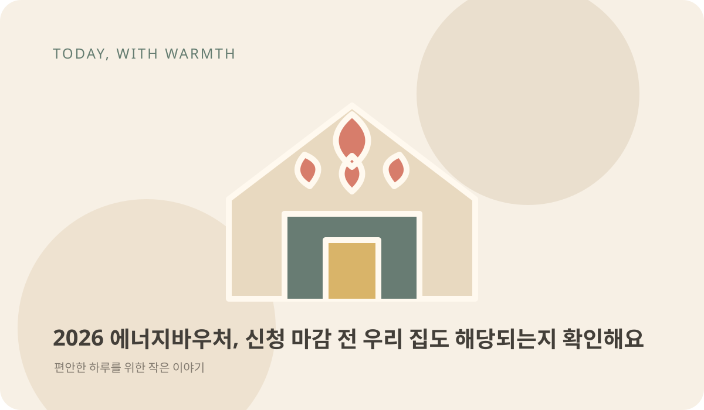

# 2026 에너지바우처, 신청 마감 전 우리 집도 해당되는지 확인해요

> **한 줄 요약:** 2026년 에너지바우처는 12월 31일까지 신청할 수 있어요. 소득 기준과 세대원 조건을 함께 확인하고, 대상이라면 사용 방식과 남은 기간도 챙겨보세요.

> 이미지: 글 주제에 맞춰 매거진에서 직접 만든 그림입니다.

날씨가 차가워지면 난방비부터 걱정되죠. 올해는 에너지바우처 신청 기간이 아직 남아 있어요. **신청 마감은 2026년 12월 31일**이라, 해당할 수 있는 가족이 있다면 지금 확인해보는 게 좋아요.

| 한눈에 볼 항목 | 2026년 안내 |
| --- | --- |
| 신청 마감 | 2026년 12월 31일 |
| 사용 기간 | 2026년 7월 1일~2027년 5월 31일 |
| 지원 총액 | 가구원 수에 따라 29만 5,200원~70만 1,300원 |
| 신청 창구 | 주소지 읍·면·동 행정복지센터 |
| 문의 | 에너지바우처 상담센터 1600-3190 |

## 어떤 가구가 신청할 수 있나요?

에너지바우처는 소득 기준과 세대원 특성 기준을 모두 충족해야 해요. 기초생활보장 생계·의료·주거·교육급여 수급 가구 중, 세대원에 노인이나 영유아, 장애인, 임산부, 중증·희귀·난치 질환자, 한부모가족, 소년소녀가정, 다자녀가구 기준에 해당하는 사람이 있어야 해요. **두 기준을 함께 확인하는 게 첫걸음이에요.**

여기서 노인 기준은 **주민등록상 1961년 12월 31일 이전 출생자**예요. 부모님이 연세가 있으시더라도 소득 기준과 세대원 조건을 함께 봐야 하니, 나이만으로 받을 수 있다고 단정하지는 마세요.

세대원 모두가 보장시설에서 급여를 받는 경우에는 지원 대상에서 제외돼요. 동절기 연료비나 연탄쿠폰 등 다른 지원과 중복되지 않는지도 확인해야 해요. **지원 제외나 중복 기준은 가구마다 다를 수 있으니** 세부 내용을 [2026 에너지바우처 공식 안내](https://www.energyv.or.kr/info/support_info.do)에서 살펴보세요.

## 지원 금액은 얼마이고 언제까지 쓰나요?

지원액은 세대원 수에 따라 달라져요. 공식 안내 기준으로 1인 가구는 총 29만 5,200원, 2인 가구는 40만 7,500원, 3인 가구는 53만 2,700원, 4인 이상 가구는 70만 1,300원이에요. **월마다 받는 돈이 아니라 사용 기간 전체에 쓰는 총액**이라는 점이 중요해요.

사용 기간은 2026년 7월 1일부터 2027년 5월 31일까지예요. 전기·도시가스·지역난방 요금에서 차감받거나 국민행복카드로 전기, 도시가스, 등유, LPG, 연탄을 구입하는 방식이 있어요. **우리 집에서 실제 쓰는 에너지원에 맞춰 신청 방식을 고르면 돼요.**

지원 금액을 볼 때는 가구원 수가 주민등록상 세대 기준으로 어떻게 반영되는지 확인해야 해요. 혼자 사는 부모님 댁과 자녀가 함께 사는 집은 각각 별도 가구로 심사될 수 있고, 실제로 함께 지내는지와 주민등록 상태가 다를 수도 있거든요. **가족이 대신 신청을 알아볼 때도 주소와 세대 구성을 먼저 확인해요.**

바우처 금액은 현금으로 자유롭게 인출하는 지원금이 아니에요. 선택한 사용 방식과 대상 에너지원에 따라 요금에서 차감되거나 카드를 통해 결제하는 방식이에요. **받을 수 있는 총액만 보지 말고, 우리 집에서 실제로 결제할 수 있는 에너지원인지 함께 살펴봐야 해요.**

## 요금 차감과 국민행복카드, 어떻게 고를까요?

전기나 도시가스처럼 고지서가 매달 오는 에너지를 주로 쓴다면 요금 차감 방식이 편할 수 있어요. 반면 등유나 연탄처럼 직접 구매하는 연료를 쓰는 집은 국민행복카드 방식이 맞을 수 있죠. **가구마다 난방 방식이 다르니 이웃이 고른 방법을 그대로 따라가기보다 현재 쓰는 에너지부터 확인해요.**

신청 전에 최근 고지서를 준비해두면 전기·가스 고객번호나 공급자 정보를 확인하기 쉬워요. 카드 방식은 카드를 사용할 수 있는 판매처와 결제 방법을 미리 확인해두세요. **잘 모르겠다면 신청 창구에서 사용 에너지원과 함께 상담하고 결정해도 늦지 않아요.**

## 신청한 뒤에도 한 번 더 확인해요

신청을 마쳤다면 접수 여부만으로 끝내지 말고, 지원 대상 선정과 사용 방식이 어떻게 처리됐는지 확인해요. 이사했거나 에너지 공급자·요금 납부 정보가 바뀌었다면 적용에 차이가 생길 수 있어요. **주소나 요금 정보가 달라졌을 때는 행정복지센터나 공식 상담센터에 먼저 알려주세요.**

바우처 잔액은 사용 기간이 끝나기 전에 확인하는 편이 좋아요. 겨울철에 난방비를 많이 썼는지, 아직 카드에 남은 금액이 있는지 살펴보고 필요한 사용 계획을 세워요. **잔액을 현금처럼 돌려받는다고 기대하기보다 사용 기한과 가능한 결제처를 공식 안내에서 확인해야 해요.**

## 신청은 어디서 하고, 어떻게 확인하나요?

주민등록상 주소지의 읍·면·동 행정복지센터에서 신청할 수 있어요. 거동이 불편한 분은 친족이 대신 신청할 수 있고, 본인 동의를 받은 담당 공무원의 직권 신청도 가능해요. **요금 차감을 원한다면 최근 요금고지서를 챙겨가세요.**

이미 신청했는지 헷갈린다면 [에너지바우처 잔액 조회](https://www.energyv.or.kr/info/balance_inquiry.do)를 확인하거나 통합상담센터 **1600-3190**에 문의해보세요. **상담 시간은 평일 오전 9시부터 오후 6시까지**예요.

## 신청 전 체크리스트

- 우리 가구가 기초생활보장 급여 대상인지 확인해요.
- 주민등록상 세대원 중 특성 기준에 해당하는 사람이 있는지 살펴봐요.
- 연탄쿠폰이나 다른 동절기 연료비 지원을 받고 있는지 확인해요.
- 요금 차감과 국민행복카드 중 우리 집에 맞는 방식을 물어봐요.
- 신청을 재촉하며 링크를 누르라고 하는 문자는 조심해요.
- 신청 후에는 접수와 사용 방식이 제대로 등록됐는지 확인해요.
- 사용 종료일과 잔액을 미리 살펴보고 남은 기간을 계산해요.

**공식 에너지바우처는 ‘전 국민 지급’이 아니고, 문자에 개인정보나 금융정보를 입력하라고 요구하지 않아요.** 의심스러운 링크는 누르지 말고 공식 홈페이지나 상담센터를 통해 확인하는 편이 안전해요.

## 부모님 신청을 도울 때는 이렇게 확인해요

부모님이 신청 대상일 수 있지만 온라인 정보만으로 조건을 판단하기 어렵다면, 먼저 주민등록상 세대와 급여 수급 여부를 확인해요. **가족이 대신 신청을 알아보더라도 당사자 동의 없이 개인정보를 전달하지 않는 게 중요해요.**

행정복지센터에 전화하거나 방문할 때는 “우리 집이 대상인가요?”라고만 묻기보다 급여 종류, 세대원 연령과 특성, 이미 받고 있는 겨울철 지원이 있는지 차례대로 설명하면 상담이 수월해요. 필요한 서류는 가구 상황에 따라 달라질 수 있으니 **방문 전에 담당 창구에 준비물을 문의하면 헛걸음을 줄일 수 있어요.**

신청 기한이 가까워질수록 문의가 몰릴 수 있어요. 대상일 가능성이 있다면 가족끼리 확인을 미루지 말고, 공식 안내에 적힌 접수 기간 안에 신청 여부를 확인해요. **확실하지 않은 부분은 소셜미디어 게시물보다 공식 상담을 우선해요.**

### 자주 묻는 질문

**Q. 65세가 넘으면 누구나 신청할 수 있나요?**

**아니에요.** 나이 기준뿐 아니라 기초생활보장 급여 등 소득 기준과 세대원 특성 기준을 함께 충족해야 해요.

**Q. 지원금은 매달 같은 금액으로 들어오나요?**

**아니에요.** 가구원 수에 따라 정해진 총액을 사용 기간 안에서 쓰는 방식이에요.

**Q. 신청 후 잔액은 어디서 확인하나요?**

**공식 홈페이지에서 조회**하거나 에너지바우처 통합상담센터 1600-3190에 문의하면 돼요.

출처:
- [에너지바우처 2026 지원 대상·금액·신청 기간](https://www.energyv.or.kr/info/support_info.do)
- [에너지바우처 사용 안내](https://www.energyv.or.kr/info/use_info.do)
- [에너지바우처 공식 홈페이지·잔액 조회](https://www.energyv.or.kr/)
