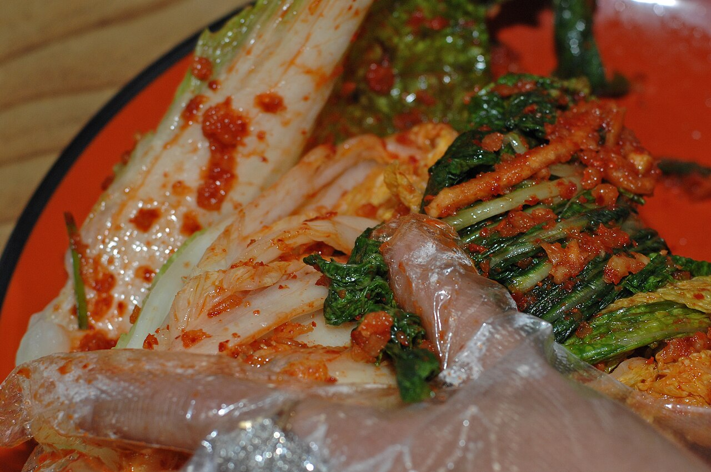

# 김장철 배추 한 통, 남은 잎까지 맛있게 쓰는 15분 배추전

> **한 줄 요약:** 김장 비용이 낮아졌다는 소식에 장바구니를 다시 보게 되는 11월이에요. 남은 배추 잎 몇 장으로 간단한 배추전을 부쳐 따뜻한 한 끼를 만들어봐요.

> 이미지 출처: [Kimchi making](https://commons.wikimedia.org/wiki/File:Kimchi_making.jpg) · CC BY 2.0 · USAG- Humphreys

배추가 집에 들어오면 김치만 담그기엔 아깝죠. 2026년 11월 10일 [연합뉴스가 전한 aT 조사](https://www.yna.co.kr/view/AKR20261109136951030)에서는 4인 가구 기준 김장 비용이 19만 9천 원으로, 지난해보다 9% 낮아졌다고 해요. 다만 이건 정해진 품목과 기준으로 계산한 추정치라 **동네와 구입처, 실제로 담그는 양에 따라 우리 집 장보기 금액은 달라져요.**

김장을 크게 하지 않아도 괜찮아요. 배추 몇 장은 전으로 부치고, 남은 건 국이나 겉절이에 나눠 쓰면 버리는 부분을 줄일 수 있어요. **오늘은 손질도 간단한 배추전을 같이 만들어볼게요.**

| 한눈에 볼 내용 | 요점 |
| --- | --- |
| 준비 시간 | 약 15분, 배춧잎 4~6장 기준 |
| 기본 재료 | 배추, 부침가루 또는 밀가루, 달걀, 물, 식용유 |
| 불 조절 | 중약불에서 앞뒤로 천천히 익혀요 |
| 장보기 정보 | 2026년 aT 김장 비용은 조사 기준에 따른 4인 가구 추정치예요 |

## 재료는 냉장고에 있는 만큼만 준비해요

배춧잎 4~6장, 부침가루나 밀가루 5큰술, 달걀 1개, 물 4~5큰술, 식용유를 준비해요. 부침가루를 쓰면 간이 들어 있으니 소금은 먼저 넣지 않는 게 좋아요. **배추 크기가 다르니 물은 한꺼번에 붓지 말고 반죽을 보며 맞춰요.**

배춧잎은 흐르는 물에 씻고 물기를 털어주세요. 잎줄기가 두껍다면 칼등으로 살짝 눌러 평평하게 만들면 팬에 잘 닿아요. **잎이 너무 크면 반으로 잘라 뒤집기 쉽게 준비해요.**

## 15분 배추전, 이렇게 부쳐요

1. 그릇에 부침가루와 달걀을 넣고 물을 조금씩 부어 묽은 반죽을 만들어요.
2. 달군 팬에 기름을 얇게 두르고 배춧잎 앞뒤로 반죽을 입혀 올려요.
3. 중약불에서 2~3분씩 앞뒤를 익혀요. 잎 가장자리가 노릇해지고 줄기가 부드러워지면 꺼내요.
4. 간장 1큰술에 식초 몇 방울을 넣어 곁들이면 담백하게 먹기 좋아요.

**센 불로 급하게 익히기보다 중약불에서 천천히 부쳐야 잎이 타기 전에 줄기까지 익어요.** 팬이 작으면 잎을 반으로 잘라 두 번에 나눠 부치면 모양이 더 편해요.

반죽은 국자에서 천천히 흘러내릴 정도로 맞추면 배춧잎에 얇게 입히기 좋아요. 너무 되직하면 잎보다 반죽 맛이 앞서고, 지나치게 묽으면 팬에 올릴 때 가장자리로 흘러내릴 수 있어요. **물을 조금씩 넣으며 농도를 조절하면 실패할 가능성이 줄어요.**

배춧잎 줄기가 두꺼우면 잎과 줄기의 익는 속도가 달라요. 줄기 부분을 칼등으로 가볍게 눌러 두께를 고르게 하면 뒤집기도 수월하죠. 팬에 올린 뒤 가장자리가 굳기 시작하면 넓은 뒤집개로 받쳐 한 번에 뒤집어요. **반죽이 익기 전에 여러 번 건드리지 않는 게 모양을 지키는 요령이에요.**

## 냉장고 재료에 맞춰 맛을 바꿔봐요

부침가루가 없다면 밀가루에 달걀과 물을 섞어 기본 반죽을 만들고, 간은 간장 양념으로 조절해요. 집에 쪽파가 조금 남았다면 잘게 썰어 반죽에 넣을 수 있고, 매콤한 맛이 좋다면 청양고추를 소량 곁들여도 괜찮아요. **추가 재료는 배추 맛을 덮지 않을 만큼만 넣는 게 좋아요.**

달걀을 넣지 않는 방식으로 만들고 싶다면 밀가루나 부침가루에 물을 섞어 반죽하면 돼요. 반죽이 얇게 입혀지도록 농도를 맞추고, 팬에 올린 뒤 잎을 눌러가며 익혀주세요. **가족의 알레르기나 식단 제한이 있다면 포장지의 원재료 표시를 먼저 확인해요.**

배추전은 초간장에 찍어 먹어도 좋고, 간을 약하게 했다면 김치나 따뜻한 국과 함께 내도 잘 어울려요. 한 끼 반찬으로 먹을 때는 전을 너무 두껍게 부치기보다 잎 한 장씩 나눠 익히면 식감이 살아나요. **한 번에 많이 만들기보다 먹을 만큼만 부치면 따뜻할 때 즐기기 편해요.**

## 남은 배추는 다음 끼니까지 알뜰하게 써요

손질한 배추가 남았다면 물기를 털어 밀폐 용기에 담아 냉장 보관하고, 가능한 한 신선할 때 사용해요. 잎이 넉넉하면 국에 넣거나 겉절이로 활용할 수 있고, 줄기 부분은 볶음이나 된장국에 더해도 좋아요. **보관 중 물러지거나 냄새가 달라진 재료는 사용하지 않는 게 안전해요.**

배추전을 미리 부쳤다면 실온에 오래 두지 말고 식힌 뒤 냉장 보관해요. 다시 데울 때는 팬에 약한 불로 앞뒤를 데우면 겉면이 덜 눅눅해져요. **한 번 먹을 양만 덜어 데우고, 남은 전을 반복해서 꺼내지 않도록 해요.**

## 김장 비용 소식은 이렇게 읽어봐요

aT 기준 김장 비용은 전년보다 줄었지만, 집에서 필요한 양이 모두 같지는 않아요. 배추 외에 고춧가루, 젓갈, 마늘, 소금까지 어떤 재료를 얼마나 사느냐가 전체 비용을 바꾸거든요. **‘평균 비용’은 비교의 출발점이지, 모든 집에서 똑같이 드는 금액은 아니에요.**

김장을 하기로 했다면 먼저 배추와 양념 재료를 적어보고, 이미 집에 있는 재료를 빼보세요. **직거래 장터나 할인 행사는 날짜와 품목이 다를 수 있으니** 방문 전에 주최 측 공지를 확인하는 게 좋아요.

### 오늘의 작은 장보기 체크

- 배추는 필요한 양부터 정하고 여분을 무리해서 사지 않아요.
- 반으로 잘랐을 때 속이 단단하고 잎이 상하지 않았는지 살펴봐요.
- 김장용과 바로 먹을 반찬용을 구분해 보관해요.
- 가격 비교는 할인율뿐 아니라 실제 무게와 판매 단위를 함께 봐요.

**배추전은 남은 잎으로 한두 장만 부쳐도 충분히 별미가 돼요.** 집에 배추가 있다면 오늘 저녁 따뜻하게 한 접시 올려볼까요?

## 한두 장부터 실패 없이 부쳐봐요

처음 배추전을 만들 때는 배춧잎 한 장만 먼저 부쳐 반죽 농도와 간을 확인해요. 배추 자체의 단맛과 수분이 있어 반죽을 진하게 할 필요는 없어요. **첫 장을 맛본 뒤 남은 반죽의 간을 조절하면 한꺼번에 만든 음식을 아깝게 버리는 일을 줄일 수 있어요.**

팬 크기에 맞춰 잎을 나눠 올리고, 전이 겹치지 않게 간격을 둬요. 여러 장을 한꺼번에 올리면 팬 온도가 떨어지고 뒤집기도 어려워질 수 있어요. **좁은 팬에서는 작은 전으로 나눠 부치는 편이 모양과 익힘을 확인하기 쉬워요.**

기름은 팬 바닥에 얇게 펴 바르고 부족할 때 조금 더해요. 처음부터 많이 두르면 전 가장자리가 기름을 머금고 무거워질 수 있어요. 불이 너무 세면 반죽이 먼저 갈색으로 변해 배추 줄기가 덜 익을 수 있으니, 한 장을 익히는 동안 불과 시간을 살펴주세요. **노릇한 색만 보고 서두르지 말고 줄기까지 부드러운지 확인해요.**

배추전은 얇고 담백하게 부치면 간식으로, 달걀을 더해 도톰하게 만들면 든든한 반찬으로 즐길 수 있어요. 다만 모양을 바꾸려고 재료를 많이 추가하면 배추 특유의 맛이 가려질 수 있죠. **냉장고에 남은 재료를 활용하되 배추가 주인공이라는 점은 그대로 두면 좋아요.**

### 자주 묻는 질문

**Q. 배춧잎을 데친 뒤에 부쳐야 하나요?**

**대부분은 생잎을 씻어 바로 부쳐도 괜찮아요.** 줄기가 유난히 두껍다면 칼등으로 눌러 두께를 줄이고 중약불에서 충분히 익혀요.

**Q. 배추전이 팬에 자꾸 달라붙어요.**

**팬을 먼저 달구고 기름을 고르게 둘러주세요.** 반죽이 익기 전에 뒤집개를 대면 찢어질 수 있으니 가장자리가 익을 때까지 기다려요.

**Q. 남은 배추전은 어떻게 데우면 좋을까요?**

**팬에 약한 불로 앞뒤를 데우면 식감이 비교적 잘 살아나요.** 냉장 보관하고, 먹을 만큼만 덜어 충분히 데워주세요.

출처:
- [연합뉴스, aT 2026년 김장 비용 조사 보도(2026.11.10)](https://www.yna.co.kr/view/AKR20261109136951030)
- [한국농수산식품유통공사 농산물 유통정보 KAMIS](https://www.kamis.or.kr/)
