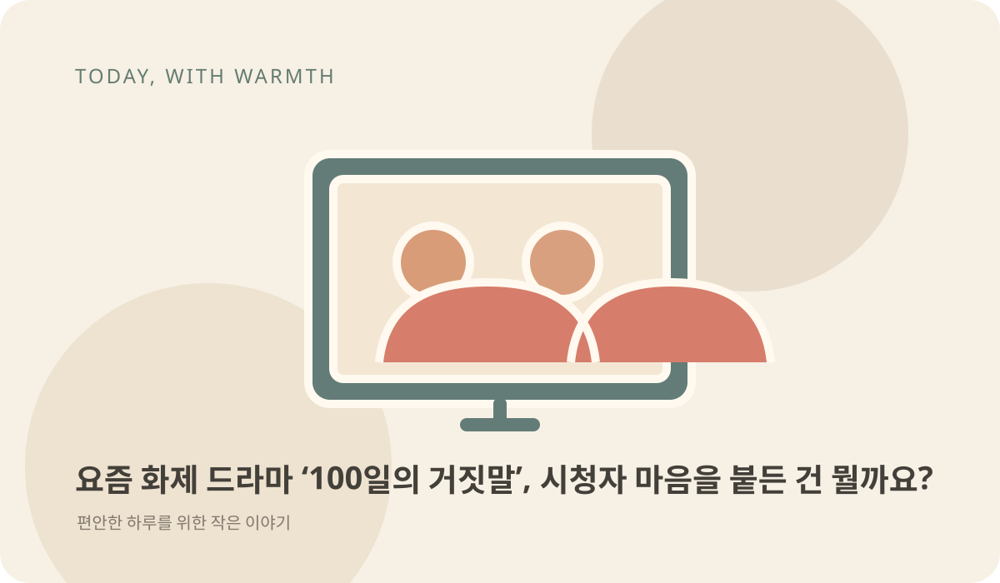

# 요즘 화제 드라마 ‘100일의 거짓말’, 시청자 마음을 붙든 건 뭘까요?

> **한 줄 요약:** ‘100일의 거짓말’이 TVING 11월 2주차 주간 콘텐츠 TOP5에서 4주 연속 1위를 기록했어요. 이 순위는 TVING 안의 주간 시청 데이터라는 점을 알고, 스포일러 없이 작품 이야기를 나눠봐요.

> 이미지: 글 주제에 맞춰 매거진에서 직접 만든 그림입니다.

요즘 가족끼리 모이면 “그 드라마 봤어?”라는 말이 먼저 나오기도 하죠. 2026년 11월 18일 [CJ 뉴스룸이 공개한 TVING 11월 2주차 주간 콘텐츠 순위](https://cjnews.cj.net/%ED%8B%B0%EB%B9%99-top5-100%EC%9D%BC%EC%9D%98-%EA%B1%B0%EC%A7%93%EB%A7%90%C2%B7%EB%82%98%EC%9D%98-%EC%9C%A0%EC%A3%84%EC%9D%B8%EA%B0%84-4%EC%A3%BC-%EC%97%B0%EC%86%8D-%EC%A2%85/)에서 **‘100일의 거짓말’이 종합·드라마 부문 1위를 4주 연속 지켰어요.** 집계 대상 기간은 11월 9일부터 15일까지예요.

여기서 말하는 순위는 TVING 안에서의 시청 데이터예요. 방송 시청률이나 온라인 화제성 순위와 같은 지표는 아니죠. **‘1위’라는 말만 보고 모든 시청자가 같은 작품을 봤거나 좋아했다고 받아들이면 곤란해요.**

| 항목 | 확인된 내용 |
| --- | --- |
| 작품 | tvN 토일드라마 ‘100일의 거짓말’ |
| 발표 | CJ 뉴스룸, 2026년 11월 18일 |
| 집계 기간 | 2026년 11월 9일~15일 |
| 결과 | TVING 종합·드라마 부문 4주 연속 1위 |
| 기준 | TVING 내 드라마·예능 VOD 주간 순 이용자 수 |

## TVING 순위와 화제성, 시청률은 어떻게 다를까요?

TVING 주간 콘텐츠 TOP5는 TVING 안의 드라마·예능 VOD를 주간 순 이용자 수(UV) 기준으로 집계해요. 방송 시청률은 방송을 본 가구나 사람의 비율을 조사하고, 화제성 순위는 별도의 기관과 방법으로 산출해요. **숫자를 볼 때는 ‘누가, 언제, 무엇을 조사했나’를 함께 확인해야 해요.**

이번 발표는 TVING의 11월 9~15일 데이터에서 ‘100일의 거짓말’이 4주 연속 종합 1위였다는 뜻이에요. **다른 OTT나 방송 채널까지 포함한 전체 시청률 1위라는 뜻은 아니에요.**

순위를 읽을 때는 작품명뿐 아니라 발표 날짜와 집계 기간도 살펴보세요. 11월 18일에 공개된 자료는 11월 9일부터 15일까지의 시청 데이터를 다뤄요. **보도일이 곧 집계가 끝난 날짜는 아니니 두 날짜를 나눠 읽어야 해요.**

‘4주 연속’이라는 표현도 어느 기간과 차트를 기준으로 했는지 확인하면 오해가 줄어요. 이번 자료는 TVING 11월 2주차의 주간 콘텐츠 TOP5를 다루며, 종합과 드라마 부문 순위를 함께 소개했어요. **주간 이용자 순위와 특정 회차의 시청률은 서로 다른 숫자예요.**

주간 순위는 한 주 동안의 이용 패턴을 보여주는 자료라서, 한 회의 반응과는 시간 단위가 달라요. 어떤 회차가 특히 재미있었는지 궁금하다면 해당 방송사의 회차별 시청률이나 공식 소개를 따로 확인할 수 있어요. **비교할 때는 같은 기간과 같은 집계 기준을 맞춰야 의미가 있어요.**

또한 TVING 순위는 해당 서비스 이용자 자료예요. 서비스를 이용하지 않는 사람의 감상까지 대표한다고 볼 수 없고, 모든 연령대가 같은 방식으로 시청했다고 단정할 수도 없어요. **한 차트가 알려주는 범위를 넘어서 해석하지 않는 게 숫자를 정확히 읽는 방법이에요.**

가령 가족 단톡방에서 “요즘 그 드라마가 인기래”라는 말을 들었다면, 어느 플랫폼의 어떤 주간 순위인지 한 번 더 물어봐도 좋아요. **정확한 기준을 알면 서로 다른 순위를 두고 엇갈리는 대화를 줄일 수 있어요.**

자세한 집계 기준과 같은 주간의 다른 프로그램은 [CJ 뉴스룸 원문](https://cjnews.cj.net/%ED%8B%B0%EB%B9%99-top5-100%EC%9D%BC%EC%9D%98-%EA%B1%B0%EC%A7%93%EB%A7%90%C2%B7%EB%82%98%EC%9D%98-%EC%9C%A0%EC%A3%84%EC%9D%B8%EA%B0%84-4%EC%A3%BC-%EC%97%B0%EC%86%8D-%EC%A2%85/)에서 확인할 수 있어요. **자료를 직접 확인하면 제목만 보고 생기는 오해를 줄일 수 있어요.**

한 주의 순위는 그 기간에 서비스를 이용한 사람들의 기록이지, 작품의 완성도를 점수로 매긴 결과는 아니에요. **순위는 작품을 발견하는 힌트로 활용하고, 볼지는 본인의 취향으로 정하면 돼요.**

## 순위만 보고 작품을 고르기보다 취향을 확인해요

인기 순위는 아직 볼 작품을 고르는 출발점으로 쓸 수 있어요. 다만 가족끼리 취향이 다르다면 장르, 회차 수, 분위기를 먼저 살펴보고 각자 보고 싶은 작품을 고르는 것도 방법이죠. **순위가 높다는 이유만으로 내 취향에도 꼭 맞는다고 단정할 필요는 없어요.**

작품 정보를 확인할 때는 공식 소개에서 장르와 방송 시간, 다시보기 제공 여부를 보고, 결말을 알고 싶지 않다면 검색어 뒤에 ‘결말’을 붙이지 않는 편이 안전해요. 추천 글이나 댓글에는 스포일러가 섞일 수 있으니 읽기 전에 주의 문구를 살펴봐요. **보고 싶은 즐거움을 지키려면 검색 범위부터 조절하면 돼요.**

특정 플랫폼을 이용하지 않는 가족에게는 순위만으로 구독을 권하기보다, 이용권 조건과 제공 콘텐츠를 직접 확인하라고 알려주세요. 요금제나 제공 목록은 시기에 따라 달라질 수 있으니 오래된 게시물만 믿지 않는 편이 좋아요. **가입이나 결제 전에는 공식 서비스 페이지의 최신 안내를 확인해요.**

드라마를 함께 볼 때는 자막 크기와 음량, 시청 시간을 각자 편하게 맞추는 것도 작은 배려예요. 한 회를 다 보고 나서 각자 좋아한 인물을 이야기하면 순위보다 취향이 먼저 보이기도 하죠. **누가 더 많이 봤는지보다 누구와 어떤 이야기를 나눴는지가 오래 남을 수 있어요.**

## 드라마 수다는 결말보다 마음에 남은 점부터

드라마 이야기를 할 때는 결말을 먼저 말하지 말고, “인물 관계가 흥미롭더라”, “어떤 장면이 마음에 남았어?”처럼 가볍게 시작해보세요. **아직 못 본 가족에게는 스포일러를 피하고**, 보고 난 사람끼리는 각자 다르게 느낀 이유를 나누면 대화가 길어져요.

높은 주간 이용자 수만으로 사람들이 작품을 선택한 이유까지 알 수는 없어요. 배우의 연기나 이야기의 속도처럼 각자 마음에 든 점은 다를 수 있죠. **순위는 이용 경향을 보여주고, 감상은 시청자마다 다르다는 점을 함께 기억해요.**

## 오늘 드라마 이야기 나누는 작은 방법

- 작품 이름과 기사 날짜를 함께 확인해요.
- TVING 주간 순위를 방송 시청률이나 전체 화제성으로 착각하지 않아요.
- 기사 제목만 보고 줄거리나 결말을 단정하지 않아요.
- 아직 보지 않은 사람에게는 스포일러를 묻고 나눠요.
- “나는 이 장면이 좋았어”처럼 내 감상과 사실을 구분해요.

### 자주 묻는 질문

**Q. TVING 1위면 방송 시청률도 1위인가요?**

**아니에요.** TVING VOD의 주간 이용자 순위와 방송 시청률은 집계 대상과 방식이 달라요.

**Q. 기사에 나온 순위는 언제 기준인가요?**

**보도 날짜와 조사 주간을 확인해야 해요.** 순위는 시간이 지나면 바뀔 수 있어요.

**Q. 가족에게 드라마를 추천할 때는 뭘 말하면 좋을까요?**

**결말은 미리 알려주지 말고**, 어떤 분위기의 작품인지와 본인이 재미있게 본 이유를 짧게 말해보세요.

**화제의 작품도 결국은 각자 마음에 남는 장면이 다르잖아요.** 오늘 본 드라마에서 가장 기억에 남은 순간이 있다면, 가족이나 친구와 스포일러 없이 이야기해보세요.

출처:
- [CJ 뉴스룸, TVING 11월 2주차 주간 콘텐츠 TOP5(2026.11.18)](https://cjnews.cj.net/%ED%8B%B0%EB%B9%99-top5-100%EC%9D%BC%EC%9D%98-%EA%B1%B0%EC%A7%93%EB%A7%90%C2%B7%EB%82%98%EC%9D%98-%EC%9C%A0%EC%A3%84%EC%9D%B8%EA%B0%84-4%EC%A3%BC-%EC%97%B0%EC%86%8D-%EC%A2%85/)
- [미디어펜, ‘100일의 거짓말’ 4주 연속 1위 보도(2026.11.18)](https://www.mediapen.com/news/view/1138207)
