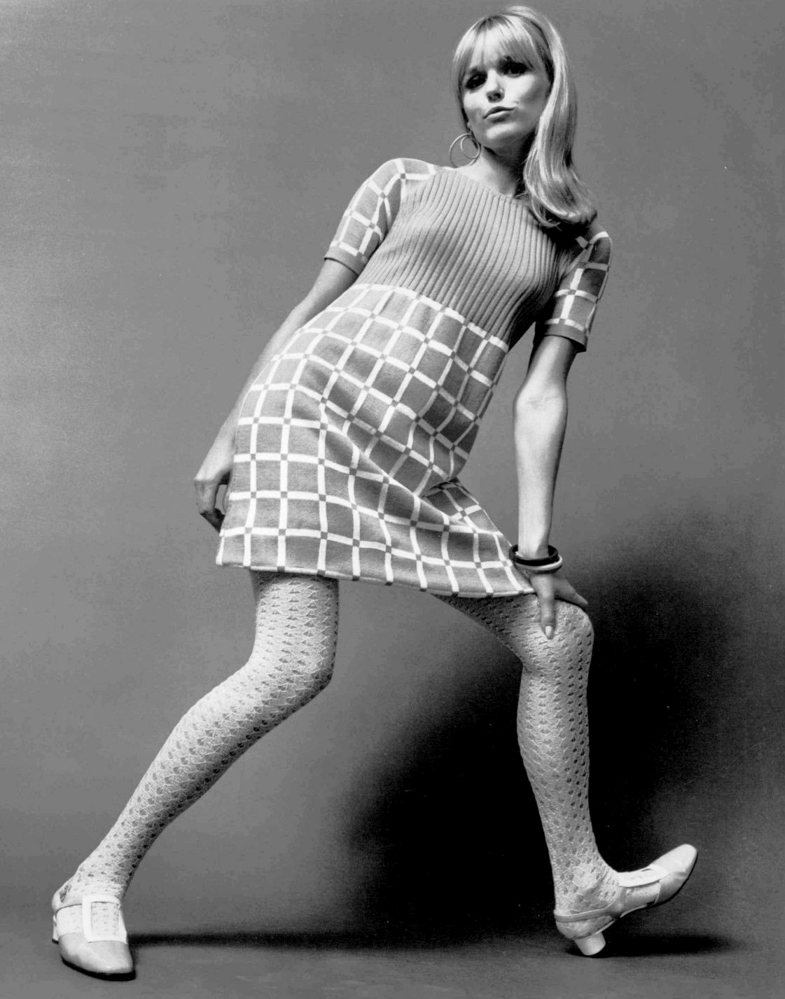

# 올겨울 대세 꽈배기 니트, 체형 걱정 없이 입는 법 4가지

> **한 줄 요약:** 꽈배기 니트는 볼륨감이 있지만 패턴 굵기·길이·컬러를 고르면 50~60대 체형을 오히려 감각적으로 보완해줘요.

*이미지: Wikimedia Commons, Public domain*

올겨울 패션 트렌드에서 꽈배기 니트가 빠지지 않아요. 보그코리아도 "올겨울 유행할 니트는 할아버지 옷장에 있다"는 제목으로 복고풍 텍스처 니트를 주목했는데요, 사실 50~60대 분들은 꽈배기 니트를 오랫동안 즐겨 오셨잖아요. **이번 겨울엔 트렌드와 체형 보완 두 가지를 한 번에 잡을 수 있는 절호의 찬스예요.**

## 체형을 살리는 꽈배기 니트 고르는 법

꽈배기 니트는 패턴 자체에 볼륨이 있어서 무조건 두꺼워 보인다고 생각하시는 분들이 많아요. 하지만 소재와 패턴 굵기에 따라 느낌이 완전히 달라져요.

- **패턴이 가는 것 선택**: 굵은 꽈배기보다 가는 케이블 패턴이 훨씬 세련되고 덜 부해 보여요
- **세미핏 길이**: 엉덩이를 살짝 덮는 세미롱 길이가 배와 허리라인을 편하게 커버해줘요
- **앞뒤 패턴 확인**: 앞면에만 패턴이 있고 뒷면은 무지인 디자인이 등선을 덜 강조해요

## 체형별 코디 요령

### 어깨가 넓다면
**어깨선이 자연스럽게 흘러내리는 슬라우치 핏을 고르세요.** 어깨 솔기가 아예 없거나 한 치수 크게 입으면 각진 어깨 대신 부드러운 라인이 살아나요.

### 배·허리가 신경 쓰인다면
허리 라인을 강조하지 않는 박시한 스타일이 제일 편해요. 단, 너무 짧으면 오히려 배가 더 보일 수 있어서 **배꼽 아래 5~7cm를 덮는 길이**가 황금 기준이에요.

### 하체가 신경 쓰인다면
니트 하단을 바지 안에 살짝 넣어 세로 라인을 만들거나, 슬림한 스트레이트 팬츠나 부츠와 매치하면 균형이 맞아요.

## 컬러 고르는 요령

베이지, 오트밀, 아이보리 같은 뉴트럴 톤이 꽈배기 텍스처와 가장 잘 어울려요. **짙은 카멜이나 버건디 같은 따뜻한 중간 톤도 얼굴에 생기를 더해줘요.** 어두운 차콜이나 블랙은 꽈배기의 입체감이 잘 살아나서 슬림해 보이는 효과까지 있어요.

흰색은 얼굴을 밝게 해주지만 가슴 쪽 볼륨이 더 도드라질 수 있으니, 흰색 꽈배기 니트를 입을 때는 카디건을 살짝 걸쳐 볼륨을 나눠주는 게 좋아요.

## 함께 입으면 좋은 하의

| 하의 | 어울리는 이유 |
|---|---|
| 스트레이트 팬츠 | 상하체 볼륨을 균형 있게 잡아줘요 |
| 와이드 팬츠 | 여유로운 실루엣으로 계절감이 살아요 |
| A라인 미디 스커트 | 허리 아래를 부드럽게 감싸서 여성스러워요 |
| 슬림 조거 팬츠 | 캐주얼하게 편하면서도 세련돼 보여요 |

## 자주 묻는 질문

### Q. 꽈배기 니트는 세탁이 어렵지 않나요?
A. 울이나 캐시미어 혼방이 많아서 손세탁이나 울 모드 세탁이 기본이에요. 망에 넣어 세탁하면 패턴이 눌리지 않고 모양도 오래 유지돼요.

### Q. 50대에게 꽈배기 니트 한 장 추천한다면 어떤 색이 좋을까요?
A. 오트밀이나 카멜 계열이 가장 활용도가 높고 얼굴색도 환하게 해줘요. 가지고 계신 코트나 팬츠 색에 맞춰 고르시면 실패가 없어요.

올겨울엔 오랫동안 옷장 속에 있던 꽈배기 니트를 꺼내보거나, 하나 새로 장만해보시는 건 어떨까요?

출처: 보그코리아 "올겨울 유행할 니트는 할아버지 옷장에 있습니다"(2026.11.05), W코리아 "꽈배기 니트 없이 어떻게 겨울을 나요"(2026년), 엘르코리아 브이넥 니트 아이템 안내(2026년).
