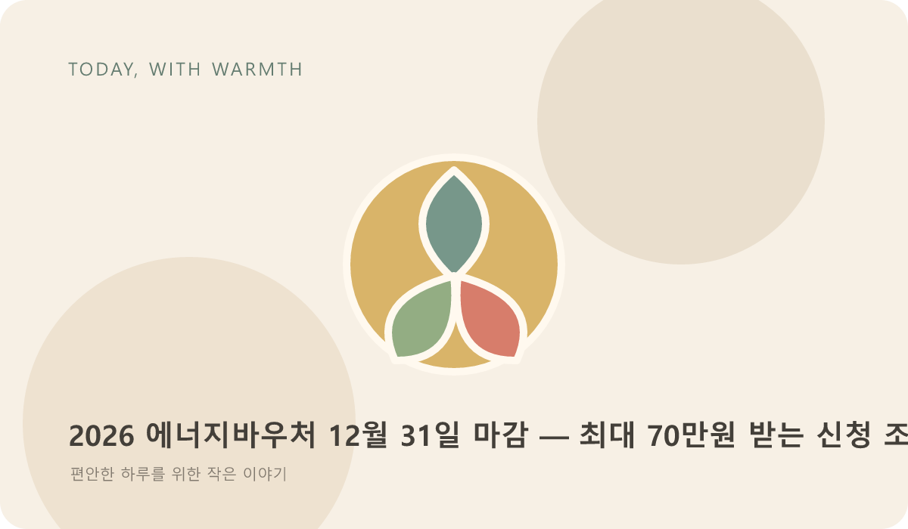

# 2026 에너지바우처 12월 31일 마감 — 최대 70만원 받는 신청 조건 정리

> **한 줄 요약:** 2026 에너지바우처는 12월 31일까지 신청해야 해요. 소득 급여 수급 가구이면서 노인·장애인·영유아가 있다면 복지로나 주민센터에서 꼭 확인하세요.

*이미지: 자체 제작*

겨울 난방비 걱정되시는 분들, **2026 에너지바우처 신청 기간이 12월 31일에 끝나요.** 복지로 공식 안내에 따르면 올해 에너지바우처는 6월 15일부터 12월 31일까지 접수 중이고, 아직 신청 안 하셨다면 이번 달 안에 꼭 챙겨야 해요.

## 에너지바우처란?

에너지바우처는 여름 냉방비와 겨울 난방비를 국가가 대신 지원해 주는 제도예요. 전기·도시가스·지역난방·등유·LPG·연탄 요금에 쓸 수 있어요. 한번 신청하면 카드 형태로 사용하거나 고지서에서 자동 차감되는 방식으로 편리하게 쓸 수 있어요.

**올해 지원 금액은 1인 가구 약 295,200원부터 4인 이상 가구 최대 701,300원**까지로, 여름·겨울 사용분을 합산한 연간 금액이에요.

## 신청 대상 조건 2가지

에너지바우처는 소득 기준과 세대원 특성 기준, **두 가지를 동시에 충족**해야 받을 수 있어요.

### 소득 기준
생계급여·의료급여·주거급여·교육급여 중 하나라도 현재 수급 중인 가구

### 세대원 특성 기준 (아래 중 하나 해당)
- 세대원 중 만 65세 이상 노인이 있는 경우
- 세대원 중 등록 장애인이 있는 경우
- 세대원 중 만 6세 미만 영유아가 있는 경우
- 임산부·희귀질환자·중증난치질환자 등 (관할 주민센터 확인)

두 조건 중 하나만 해당되면 안 되고, **두 가지 모두 충족**해야 한다는 점이 중요해요.

## 신청 방법

| 방법 | 절차 |
|---|---|
| 온라인 신청 | 복지로(bokjiro.go.kr) 로그인 → 복지급여 신청 → 에너지바우처 선택 |
| 주민센터 방문 | 거주지 읍·면·동 주민센터 방문, 신분증 지참 |
| 대리 신청 | 거동이 불편한 경우 가족 대리 신청 가능 (위임장·관련 서류 필요) |

복지로 홈페이지에서 본인이 대상인지 먼저 모의 계산해 볼 수 있어요. 주민센터 방문이 불편하신 분은 복지로 앱을 활용하시면 더 편해요.

## 꼭 알아야 할 주의사항

- **12월 31일까지 신청하지 않으면 해당 연도 혜택을 소급해서 받을 수 없어요**
- 긴급복지지원 동절기 연료비나 연탄쿠폰을 이미 받고 있다면 중복 지원이 안 돼요
- 재산이 기준을 초과하면 지원 대상에서 제외될 수 있어요

**지원 여부가 불확실해도 일단 복지로에서 조회해 보는 게 가장 빠른 방법**이에요.

## 자주 묻는 질문

### Q. 에너지바우처 카드는 어디서 받나요?
A. 신청 후 심사를 거쳐 국민행복카드로 발급돼요. 기존에 국민행복카드를 가지고 계신 분은 같은 카드에 충전되는 경우도 있어요.

### Q. 올해 여름에 못 쓴 냉방 바우처도 겨울에 쓸 수 있나요?
A. 하절기와 동절기 사용 기간이 나뉘어 있어서, 하절기에 남은 잔액은 동절기 사용 기간 안에 쓸 수 있는지 복지로 잔액 조회나 주민센터에서 확인하는 게 좋아요.

### Q. 올해 처음 신청해도 되나요?
A. 네, 매년 새로 신청하는 방식이에요. 조건을 갖추고 있다면 이번 달 안에 신청하시면 돼요.

12월이 채 한 달도 남지 않았어요. **주변에 고령이신 부모님이 계신다면 대신 확인해 드리는 것만으로도 큰 도움**이 돼요.

출처: 복지로 2026년 에너지바우처 신청 안내(bokjiro.go.kr, 2026.11 확인), 토스뱅크 2026 에너지바우처 신청 대상·사용기간·금액 안내(2026년), 경향신문 "에너지바우처 4인 가구 최대 70만원"(2026.06.15).
