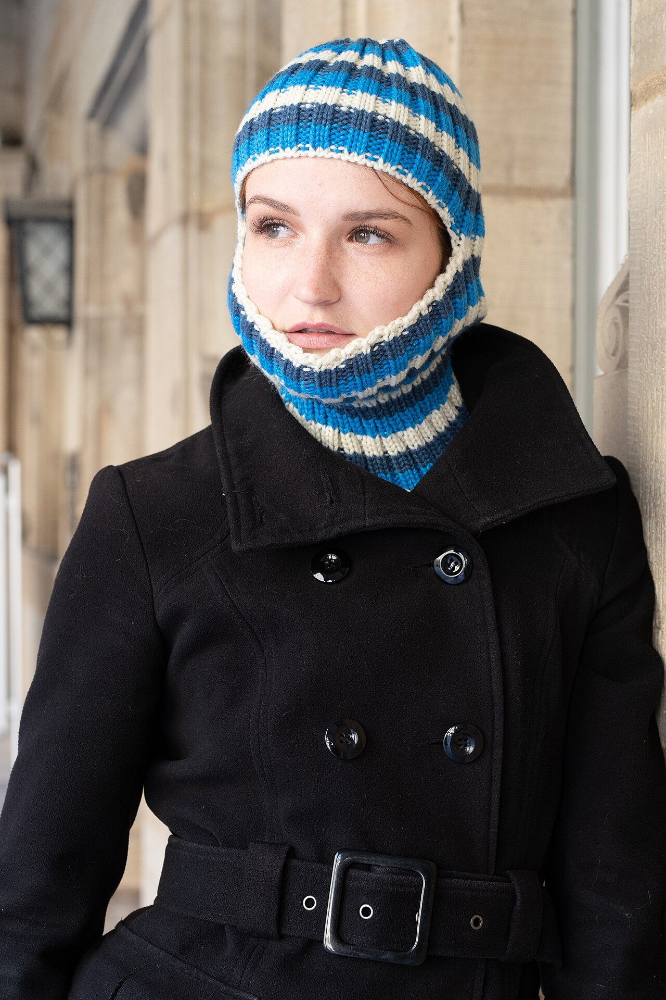

# 겨울 롱코트, 50~60대 체형에 맞게 입는 법 4가지

> **한 줄 요약:** 2026 겨울 대세 아우터인 롱코트를 50~60대 체형에 맞게 고르고 코디하는 핵심 포인트 4가지를 정리했어요.

> 이미지 출처: [Balaclava as suggested fashion piece for winter 2018 - modelled by ModelTanja](https://commons.wikimedia.org/wiki/File:Balaclava_as_suggested_fashion_piece_for_winter_2018_-_modelled_by_ModelTanja.jpg) · CC BY-SA 3.0 · Tobias ToMar Maier

롱코트 하나면 겨울 코디가 완성돼요. 그런데 막상 입어 보면 뚱뚱해 보이거나 키가 더 작아 보인다고 느끼는 분들 많죠? **무릎 아래 길이와 세로 라인만 잘 살려도** 훨씬 늘씬하고 세련된 느낌을 낼 수 있어요. 아래 4가지 포인트만 기억해 두면 쇼핑할 때도 입을 때도 흔들리지 않아요.

## ① 길이는 무릎 아래 10cm 이상이 기본

롱코트가 체형 보정에 효과적인 이유는 길이에 있어요. 무릎을 완전히 덮어서 허벅지와 엉덩이를 한 번에 가려 주거든요. 반대로 무릎 바로 위에서 끝나는 미디 길이는 허리와 엉덩이 경계가 애매하게 드러나서 오히려 하체가 강조될 수 있어요.

- 키 155cm 이하라면 발목 15~20cm 위 길이가 답답하지 않으면서도 길어 보여요.
- 키 158cm 이상이라면 발목 바로 위 맥시 길이도 충분히 소화돼요.
- 코트 안에 슬림한 스트레이트 팬츠나 청바지를 받쳐 주면 비율이 더 살아나요.

## ② 실루엣은 케이프·로브형으로 허리를 살짝 가리기

배와 허리가 신경 쓰인다면 **케이프나 로브 형태의 코트**가 훨씬 편해요. 허리 버클이 있는 로브 코트는 묶었을 때 허리가 드러나고, 풀었을 때는 여유로운 실루엣이 되니까 하루에 두 가지 느낌을 낼 수 있어요. 과하게 오버사이즈인 코트는 오히려 볼륨을 더해 보이니까 어깨선만 딱 맞는 사이즈를 고르는 게 포인트예요.

| 실루엣 | 체형 커버 | 주의할 점 |
|---|---|---|
| 케이프형 | 어깨·팔뚝 커버 | 소매통 너무 넓으면 답답해 보임 |
| 로브형 (벨트 있음) | 허리·배 커버 | 버클 위치가 너무 낮으면 역효과 |
| 클래식 더블버튼 | 가슴·어깨 강조 | 단추 간격 넓으면 체형 그대로 드러남 |

## ③ 색상은 무채색·다크 계열부터

겨울 롱코트는 블랙, 그레이, 다크브라운, 카멜처럼 무채색이나 어두운 계열이 가장 실용적이에요. 아무것도 생각하지 않고 꺼내 입어도 코디가 되니까요. 2026 겨울 트렌드로 체크 패턴이나 버건디 같은 컬러 코트도 많이 나왔는데, 처음 도전한다면 목도리나 가방으로 포인트를 주고 코트 자체는 무채색으로 가는 게 훨씬 편해요.

- **블랙·차콜:** 어느 하의와도 맞고 세로 라인이 살아요.
- **카멜·다크브라운:** 50~60대 피부 톤과 잘 어울리고 고급스러운 느낌이에요.
- **체크 패턴:** 클래식한 느낌이지만 무늬가 클수록 볼륨이 커 보일 수 있으니 작은 타탄 체크를 추천해요.

## ④ 안에 뭘 입느냐가 완성도를 결정해요

롱코트 안에 두꺼운 니트를 겹쳐 입으면 옷이 너무 두툼해 보여요. 얇은 터틀넥이나 모크넥 니트를 받치고 코트를 여미면 목 라인이 길어 보이면서 훨씬 세련된 느낌이 나요. **하의는 슬림 스트레이트 팬츠가 가장 무난하고, 발목 부분이 살짝 보이는 기장이 비율 좋아 보여요.**

- 코트 안: 얇은 모크넥 or 터틀넥 + 하이웨이스트 팬츠
- 신발: 굽 없는 첼시 부츠 or 미들 힐 앵클 부츠
- 가방: 토트백이나 미니 크로스백으로 코트 라인을 방해하지 않기

## 자주 묻는 질문

**Q. 50대 여성 체형에는 어떤 소재 롱코트가 좋아요?**
울 혼방(울 70% 이상)이 형태가 잘 잡히고 보온성도 좋아요. 가볍게 입고 싶다면 캐시미어 혼방이나 테딘 소재도 좋고요. 폴리 혼방은 가격은 저렴하지만 광택이 있어서 좀 저렴해 보일 수 있어요.

**Q. 키 작은 사람은 롱코트 피해야 하나요?**
꼭 그렇지 않아요. 발목 20cm 위 길이를 고르고 코트 안쪽은 최대한 단순하게 입으면 오히려 늘씬해 보여요. 굽 있는 부츠를 더하면 한층 비율이 좋아지거든요.

**Q. 겨울 롱코트 구입할 때 꼭 확인해야 할 것은요?**
어깨선, 소매 길이, 무게감 세 가지예요. 어깨선이 맞지 않으면 아무리 좋은 소재도 옷이 흘러내리고, 무거운 코트는 오래 입기 힘들어요.

---

겨울 옷장에 롱코트 하나만 제대로 갖춰도 출근길부터 주말 외출까지 다 해결돼요. 올해는 체형 걱정 말고 자신 있게 골라 보세요.

출처
- Vogue Korea, 「오직 겨울에만 누릴 수 있는 멋, 롱 코트 5」, 2026.11.17
- Vogue Korea, 「이번 겨울 코트 핏은 청바지를 따라갑니다」, 2026.10.26
- Who What Wear UK, 「My Mum Asked What Chic Over-50s Are Wearing This Winter—5 Trends」, 2026
