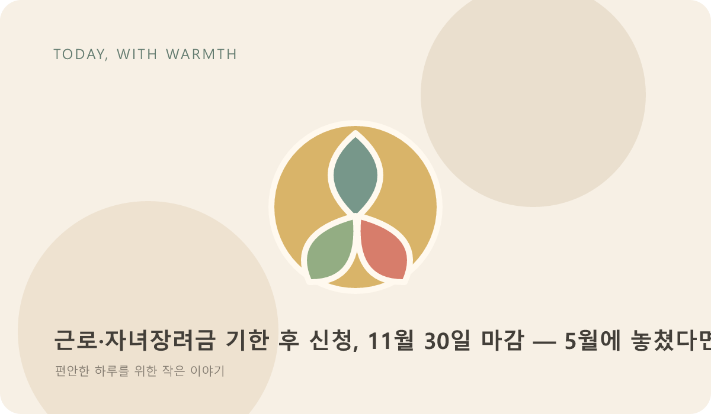

# 근로·자녀장려금 기한 후 신청, 11월 30일 마감 — 5월에 놓쳤다면 지금 바로 확인하세요

> **한 줄 요약:** 2025년 귀속 근로·자녀장려금을 5월 정기 신청에서 놓쳤다면 11월 30일까지 기한 후 신청이 가능해요. 정기 신청보다 5% 적게 받지만, 아예 못 받는 것보다는 훨씬 낫잖아요.

> 이미지: 글 주제에 맞춰 매거진에서 직접 만든 그림입니다.

5월에 근로·자녀장려금 신청을 놓친 분들, 아직 늦지 않았어요. **국세청은 2026년 11월 30일까지 2025년 귀속분 근로·자녀장려금 기한 후 신청을 받고 있어요.** 오늘(11월 27일)이면 딱 3일 남은 거예요. 조건이 된다면 오늘 바로 확인해 보세요.

## 근로·자녀장려금이 뭔가요?

국세청에서 소득이 적은 가구에 현금으로 돌려주는 세금 환급 제도예요. 일을 하고 있지만 소득이 낮거나, 자녀를 키우고 있는 가구라면 신청 조건에 맞는지 한 번씩 확인해 볼 만해요.

- **근로장려금:** 소득이 일정 기준 이하인 근로자·사업자 가구에게 지급
- **자녀장려금:** 자녀 1명당 지급 (소득 기준 충족 시)
- **신청 대상:** 2025년 한 해 소득과 재산 조건을 모두 충족하는 가구

## 기한 후 신청이란?

5월 정기 신청 기간에 신청하지 못한 분들이 이후에도 신청할 수 있도록 국세청이 운영하는 제도예요. 단, **정기 신청자보다 5% 적게 받아요.** 100만원을 받을 수 있는 가구라면 기한 후 신청 시 95만원이 지급돼요. 그래도 신청 안 하면 한 푼도 못 받으니까요.

| 구분 | 정기 신청 (5월) | 기한 후 신청 (6월~11월) |
|---|---|---|
| 지급 비율 | 산정액 100% | 산정액 95% |
| 지급 시기 | 8~9월 | 신청일로부터 4개월 이내 |
| 신청 방법 | 홈택스, 손택스, ARS, 세무서 | 동일 |

## 신청 방법

### 온라인
- **홈택스:** PC에서 홈택스(hometax.go.kr) 접속 → 세금 신고 → 근로·자녀장려금 신청
- **손택스:** 스마트폰에 손택스 앱 설치 후 간편 신청 가능

### 전화
- **자동응답 ARS:** 1544-9944로 전화해서 간단하게 신청 가능해요. 스마트폰이 익숙하지 않다면 이쪽이 더 편할 수 있어요.

### 세무서 방문
- 가까운 세무서에서 직접 신청도 가능해요.

## 꼭 알아야 할 주의 사항

**재산 합계액이 1억 7천만원 이상 2억 4천만원 미만이면 장려금의 50%만 지급돼요.** 재산이 2억 4천만원 이상이면 대상에서 제외돼요. 집값이 올라서 재산 기준을 초과하는 분들도 생기는 만큼 꼭 미리 확인해 보세요.

또 체납된 세금이 있으면 환급금 일부가 먼저 충당될 수 있어요.

## 소득·재산 기준 간단 정리

| 가구 유형 | 연간 소득 기준 (대략) |
|---|---|
| 단독 가구 | 2,200만원 미만 |
| 홑벌이 가구 | 3,200만원 미만 |
| 맞벌이 가구 | 3,800만원 미만 |

※ 정확한 소득·재산 기준과 개인별 지급 금액은 홈택스 조회 또는 국세청 장려금 상담센터(1566-3636)에서 확인하세요.

## 자주 묻는 질문

**Q. 11월 30일이 토요일인데 그날도 신청되나요?**
온라인(홈택스·손택스·ARS)은 주말과 관계없이 24시간 신청 가능해요. 세무서 방문은 평일 근무일 기준이에요.

**Q. 작년에 이미 신청해서 받은 적이 있는데 올해도 따로 신청해야 하나요?**
네, 매년 새로 신청해야 해요. 작년에 받았다고 올해 자동으로 지급되지 않아요. 국세청에서 안내문이 오지 않아도 본인이 직접 조회하고 신청하는 게 맞아요.

**Q. 조건이 되는지 모르겠어요. 어떻게 확인해요?**
홈택스 첫 화면에서 '근로·자녀장려금 → 대상 확인하기'를 클릭하면 소득·재산 조건을 바로 확인할 수 있어요. 로그인만 하면 바로 조회돼요.

---

11월 30일까지 며칠 남지 않았어요. 혹시 내 주변에 아직 신청 못 한 분이 계시다면 오늘 함께 확인해 보는 건 어떨까요?

출처
- 국세청 홈택스(hometax.go.kr), 근로·자녀장려금 안내
- 국세청 보도자료, 「2026년 근로·자녀장려금 기한 후 신청 안내」(국세청 nts.go.kr)
- SBS Biz, 「근로·자녀장려금 12월까지 신청하세요」, 2026
- 비건뉴스, 「근로·자녀장려금 기한 후 신청 12월 1일까지」, 2026
