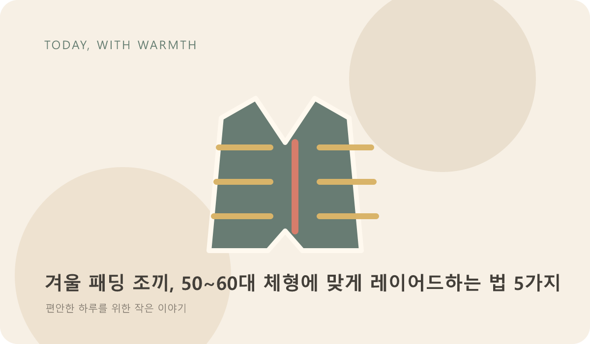

# 겨울 패딩 조끼, 50~60대 체형에 맞게 레이어드하는 법 5가지

> **한 줄 요약:** 패딩 조끼는 두꺼운 코트 없이도 따뜻하고 날씬해 보일 수 있는 겨울 레이어드 아이템이에요. 길이·누빔 방향·하의 매치 세 가지만 잡으면 50~60대 체형에 딱 맞게 연출할 수 있어요.

> 이미지: 글 주제에 맞춰 매거진에서 직접 만든 그림입니다.

겨울마다 고민되는 게 하나 있잖아요. "두꺼운 코트 입으면 따뜻한데 너무 커 보이고, 얇은 니트만 입으면 추워 죽겠고." 그럴 때 **패딩 조끼(베스트) 레이어드**가 정답이 될 수 있어요. 팔 없이 몸통만 감싸는 구조라 움직임도 편하고, 니트·재킷·코트 위에 겹쳐 입으면 보온도 스타일도 한꺼번에 잡거든요.

## 길이 선택이 핵심 — 엉덩이를 살짝 덮는 미디 기장이 정답

50~60대가 패딩 조끼를 고를 때 가장 먼저 봐야 할 건 **길이**예요. 짧은 크롭 기장은 복부가 강조될 수 있고, 무릎까지 오는 롱 기장은 키가 작아 보이기 쉬워요. 엉덩이를 살짝 덮는 미디 기장이 허리 라인을 자연스럽게 정돈해 주고 하체 비율도 좋아 보여요. 허리 조절 끈이 있는 제품이면 더 좋고요.

## 누빔 방향을 보세요 — 세로 직선이 가로보다 훨씬 슬림해 보여요

패딩 조끼를 고를 때 누빔 방향을 꼭 확인해 보세요. **세로 방향 직선 누빔**은 시선을 위아래로 길게 이어 주기 때문에 훨씬 슬림해 보여요. 반면 가로 누빔은 옆으로 퍼져 보이기 쉬워서, 복부나 허리 주변이 신경 쓰이는 분들은 피하는 게 나아요. 다이아몬드 패턴 누빔도 세로 느낌을 주기 때문에 괜찮은 선택이에요.

## 안에 입는 것 vs. 위에 입는 것 — 순서에 따라 느낌이 달라요

패딩 조끼는 두 가지 방식으로 활용할 수 있어요.

- **안쪽 레이어링:** 코트나 재킷 안에 패딩 조끼를 입으면 겉에서는 슬림해 보이면서 속은 훨씬 따뜻해요. 얇은 경량 조끼라면 이 방식이 딱 맞아요.
- **바깥 레이어링:** 니트나 티셔츠 위에 조끼를 걸치면 캐주얼하고 활동적인 느낌이에요. **부피가 있는 푸퍼 스타일**은 겉에 걸치는 편이 훨씬 세련돼 보여요.

## 하의 매치 — 상의가 볼륨 있으면 하의는 반드시 슬림하게

패딩 조끼처럼 상체에 볼륨이 생기면 **하의는 꼭 슬림한 실루엣**으로 맞춰야 해요. 스트레이트 팬츠나 슬랙스, 타이트한 레깅스 팬츠 계열이 좋아요. 아래가 넓은 와이드 팬츠는 위아래 모두 볼륨이 생겨서 체형이 훨씬 커 보일 수 있어요. 아래를 슬림하게 잡아야 비율이 살아나거든요.

## 색상 선택 — 톤온톤이 가장 세련돼 보여요

패딩 조끼와 안에 입는 니트·이너를 같은 색상 계열로 맞추는 **톤온톤 코디**가 가장 무난하면서도 세련돼 보여요. 예를 들어 베이지 조끼에 크림 니트, 네이비 조끼에 그레이 티셔츠처럼 비슷한 계열끼리 맞추면 길어 보이는 효과도 있어요. 포인트를 주고 싶다면 스카프나 머플러로 목 주변에만 색을 더하는 게 깔끔해요.

---

## 자주 묻는 질문

**Q. 50대가 패딩 조끼 입으면 너무 캐주얼해 보이지 않나요?**
A. 소재와 색상에 따라 달라져요. 광택 없는 무광 소재, 네이비·카멜·그레이 같은 클래식한 색상의 조끼라면 슬랙스나 울 스커트와 함께 입어도 충분히 세련되게 연출할 수 있어요.

**Q. 패딩 조끼는 어느 기온까지 입을 수 있나요?**
A. 경량 조끼는 10도 안팎의 환절기부터 활용할 수 있어요. 두꺼운 다운 조끼라면 영하권에서도 코트 안에 받쳐 입으면 충분히 따뜻해요.

**Q. 목 주변이 차갑게 느껴지면 어떤 조끼가 좋을까요?**
A. 하이넥(터틀넥) 디자인 조끼나 넥워머를 함께 활용해 보세요. 목 주변이 따뜻해야 전체 체온 유지에 도움이 되거든요.

---

패딩 조끼 하나 잘 고르면 올겨울 내내 편하게 입을 수 있어요. 길이, 누빔 방향, 색상 이 세 가지만 체크하고 고르면 체형 걱정 없이 따뜻하고 날씬한 겨울 코디가 완성돼요.

---

출처
- Allure Korea, "겨울 데일리 룩에는 오히려 얇은 옷이 필요합니다" (2026.11.06)
- Vogue Korea, "옷 잘 입는 사람들은 이 패딩을 선택합니다" (2026.10.28)
