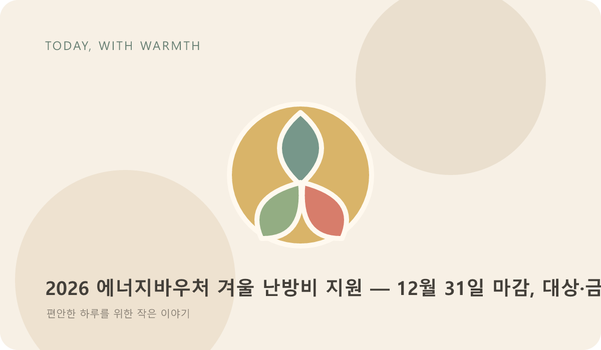

# 2026 에너지바우처 겨울 난방비 지원 — 12월 31일 마감, 대상·금액·신청 방법 총정리

> **한 줄 요약:** 기초생활수급자 가구 중 노인·영유아·장애인이 함께 사는 경우, 2026 에너지바우처로 최대 70만 원까지 난방비를 지원받을 수 있어요. 신청 마감이 12월 31일이라 지금 바로 확인해야 해요.

> 이미지: 글 주제에 맞춰 매거진에서 직접 만든 그림입니다.

겨울 난방비가 걱정되는 분들께 꼭 알려드리고 싶은 혜택이에요. 2026 에너지바우처는 취약계층 가구에 여름 냉방비와 겨울 난방비를 이용권 형태로 지원하는 제도예요. **동절기 사용 기간은 2026년 10월 1일부터 2027년 5월 31일까지**인데, 신청 기한이 12월 31일이라 아직 신청을 안 하셨다면 지금 꼭 확인해 보세요.

## 누가 받을 수 있나요? — 소득 기준 + 세대원 특성, 둘 다 충족해야 해요

에너지바우처는 두 가지 조건을 동시에 충족해야 해요.

| 조건 | 내용 |
|------|------|
| 소득 기준 | 기초생활보장법상 생계·의료·주거·교육급여 수급자 |
| 세대원 특성 | 세대 안에 노인, 영유아, 장애인 중 한 명 이상 있어야 함 |

**기초수급자여도 세대 안에 해당 세대원이 없으면 받을 수 없어요.** 예를 들어 65세 이상 어르신이 혼자 사는 1인 가구는 소득 기준만 맞으면 신청 가능해요. 반면 같은 수급 가구라도 세대 안에 노인·영유아·장애인이 없다면 신청 대상이 아니에요.

## 얼마를 지원받을 수 있나요?

2026년 에너지바우처 지원 금액은 세대원 수에 따라 달라요.

| 세대원 수 | 지원 금액 |
|----------|----------|
| 1인 세대 | 약 295,200원 |
| 3인 세대 | 약 532,700원 |
| 4인 이상 세대 | 약 701,300원 |

이 금액은 여름·겨울을 합산한 연간 전체 지원액이에요. **현금이 아니라 이용권(카드·모바일) 형태로 지급**돼요. 가스·전기·등유·연탄 등 연료 구입에 사용할 수 있어요.

## 신청 기간과 방법

- **신청 기한:** 2026년 12월 31일까지 (이후 신청 불가)
- **신청 방법 1 — 주민센터 방문:** 거주지 읍면동 주민센터에서 직접 신청
- **신청 방법 2 — 복지로 온라인:** 복지로(bokjiro.go.kr)에서 온라인 신청
- **대리 신청 가능:** 거동이 불편하신 경우 가족이 대신 신청할 수 있어요

이미 작년에 신청해서 수급 자격이 계속 유지되는 분들은 별도 신청 없이 자동으로 받는 경우가 많지만, 처음 신청하시거나 세대 상황이 바뀐 경우에는 반드시 주민센터나 복지로에서 확인해 보세요.

## 중복 수급 안 되는 경우 — 미리 확인하세요

아래 세 가지 중 하나를 이미 받고 있다면 겨울 에너지바우처를 중복해서 받을 수 없어요.

- 긴급복지지원법에 따른 동절기 연료비 (2026년 10월~2027년 3월)
- 2026년도 연탄쿠폰
- 2026년도 연탄전환 에너지바우처

---

## 자주 묻는 질문

**Q. 65세 이상 혼자 사는 어르신도 신청할 수 있나요?**
A. 기초생활수급자(생계·의료·주거·교육급여 중 하나)이면서 혼자 사는 1인 세대 노인은 신청 대상이에요. 주민센터에서 본인 수급 자격을 먼저 확인해 보세요.

**Q. 에너지바우처로 무엇을 살 수 있나요?**
A. 전기·도시가스·지역난방·등유·LPG·연탄 등 에너지 요금 납부에 사용할 수 있어요. 카드 형태로 발급되며, 에너지 판매 사업자에서 사용하면 돼요.

**Q. 작년에 받았으면 올해는 자동으로 받을 수 있나요?**
A. 계속 수급 자격이 유지되는 경우 자동 재등록되는 경우도 있지만, 가구 상황이 바뀌었거나 처음이라면 꼭 주민센터나 복지로에서 직접 확인하세요.

---

12월 31일이 마감이지만 예산이 소진되면 조기 종료될 수 있어요. 주변에 기초수급자 어르신이 계시다면 이 혜택을 꼭 알려 드리세요.

---

출처
- 토스뱅크 블로그, "2026 에너지바우처 신청 대상, 사용기간, 금액 알아봐요"
- 복지로(bokjiro.go.kr), 에너지바우처 신청 안내
- 위키트리, "최대 70만원 받는 법… 12월 31일까지 신청 안 하면 못 받는 지원금 정체" (2026.11)
- 헤럴드경제, "냉·난방비 지원 에너지바우처 신청하세요" (2026.06)
